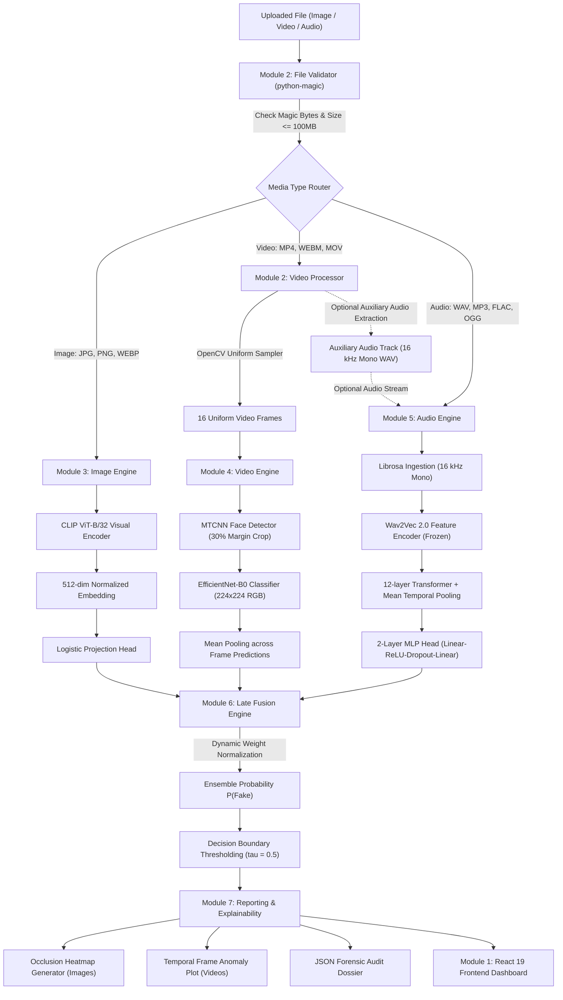

# Multimodal Deepfake & AI-Generated Content Detector

An end-to-end, forensic-grade deepfake detection platform designed to detect manipulated and artificially generated multimedia content across **Images**, **Videos**, and **Audio**. 

By leveraging foundational self-supervised models (**Wav2Vec 2.0**, **OpenAI CLIP**) and fine-tuned convolutional vision backbones (**EfficientNet-B0** with **MTCNN** face extraction), the system synthesizes multi-stream signals through a dynamically weighted late-fusion engine. It provides explainability heatmaps, temporal anomaly timelines, structured forensic audit reports, and an interactive dark-mode web application.

---

## Table of Contents

1. [Executive Summary & Problem Statement](#executive-summary--problem-statement)
2. [Key Capabilities & Innovations](#key-capabilities--innovations)
3. [System Architecture & Dataflow](#system-architecture--dataflow)
4. [Modular Deep Dive](#modular-deep-dive)
   - [Module 1: Modern Web Application (React 19 + Vite)](#module-1-user-interface--web-dashboard)
   - [Module 2: Media Validation & Extraction Pipeline](#module-2-media-validation--extraction-pipeline)
   - [Module 3: Image Detection (CLIP ViT-B/32)](#module-3-image-detection-engine)
   - [Module 4: Video Detection (MTCNN + EfficientNet-B0)](#module-4-video-deepfake-detection)
   - [Module 5: Audio & Voice Clone Detection (Wav2Vec 2.0)](#module-5-audio-deepfake--voice-clone-detection)
   - [Module 6: Dynamic Weighted Late Fusion](#module-6-multimodal-fusion-engine)
   - [Module 7: Explainability & Structured Reporting](#module-7-explainability--structured-reporting)
5. [Benchmark Evaluation & Experimental Results](#benchmark-evaluation--experimental-results)
6. [Technology Stack](#technology-stack)
7. [Repository Layout](#repository-layout)
8. [Installation & Getting Started](#installation--getting-started)
   - [Prerequisites](#prerequisites)
   - [Backend Setup (FastAPI & PyTorch)](#1-backend-setup)
   - [Frontend Setup (React & Vite)](#2-frontend-setup)
9. [Running Standalone CLI Evaluations](#running-standalone-cli-evaluations)
10. [REST API Specification](#rest-api-specification)
11. [Explainable AI & Forensic Artifacts](#explainable-ai--forensic-artifacts)
12. [Disclaimer & Ethical Use](#disclaimer--ethical-use)

---

## Executive Summary & Problem Statement

The rapid evolution of generative artificial intelligence (diffusion models, neural vocoders, latent face swapping, and voice cloning) has drastically lowered the barrier to producing indistinguishable synthetic digital media. Traditional forensics and single-modality detectors struggle with:
- **Unimodal Blindspots**: A detector analyzing only visual frames will miss a cloned audio track in a genuine video clip, while an audio-only model ignores synthetic facial stitching.
- **Compression & Transcoding Losses**: Modern social platforms recompress media, destroying traditional pixel-level sensor noise patterns.
- **Explainability Deficits**: Black-box predictions fail to provide actionable forensic justification to human reviewers.

This project addresses these challenges through a unified **multimodal framework** capable of ingesting diverse file types, routing streams through domain-specialized deep neural networks, fusing probability vectors dynamically, and producing interpretable forensic artifacts (occlusion heatmaps, temporal anomaly trajectories, and audit-ready JSON dossiers).

---

## Key Capabilities & Innovations

- **True MIME-Type Magic Header Inspection**: Bypasses deceptive file extensions using `python-magic` to inspect file signatures before execution.
- **Raw Waveform Audio Forensics**: Bypasses lossy spectrogram conversions by feeding raw $16\text{ kHz}$ waveforms directly into `facebook/wav2vec2-base`, capturing sub-millisecond vocoder synthesis artifacts with **100% recall on spoofed speech**.
- **Facial Landmark & Margin Bounding**: Employs GPU-accelerated MTCNN to isolate facial regions with a $30\%$ boundary margin expansion, capturing boundary blending discontinuities, followed by inference with ImageNet-pretrained `EfficientNet-B0`.
- **Semantic Embedding Space Analysis**: Employs `openai/clip-vit-base-patch32` to project input imagery into a 512-dimensional joint embedding space, classified via fine-tuned logistic hyperplanes.
- **Dynamically Re-weighted Late Fusion**: Intelligently handles missing modalities (e.g., audio-only files, silent video, standalone images) by recalculating relative weights on the fly.
- **Explainable AI (XAI)**:
  - **Occlusion-Sensitivity Heatmaps**: Systematically occludes $8 \times 8$ grid regions to isolate pixel clusters responsible for driving fake classifications.
  - **Temporal Frame-Score Timelines**: Visualizes frame-by-frame manipulation probabilities across video timelines to identify localized deepfake splices.
- **Production-Ready Web Experience**: React 19 interface with real-time audio/video players, file-size guards, request cancellation via `AbortController`, and clear visual confidence gauges.

---

## System Architecture & Dataflow



---

## Modular Deep Dive

### Module 1: User Interface & Web Dashboard
- **Path**: `frontend/`
- **Key Files**: `src/App.jsx`, `src/components/FileUploader.jsx`, `src/components/MediaPreview.jsx`, `src/components/ResultsDashboard.jsx`, `src/services/api.js`
- **Design Philosophy**: Built with React 19 and Tailwind CSS v4, offering a dark cybersecurity aesthetic.
- **Features**:
  - Drag-and-drop file staging area with immediate client-side size and MIME validation.
  - Multi-format preview container supporting HTML5 video, custom audio player bars, and responsive image scaling.
  - Asynchronous submission using `fetch` with `AbortController` cancellation bindings.
  - Visual metrics dashboard with color-coded confidence indicators (Green for Authentic, Red for Manipulated), probability progress bars, and forensic disclaimer notices.

### Module 2: Media Validation & Extraction Pipeline
- **Path**: `backend/src/media/`
- **Key Files**: `validator.py`, `extractor.py`, `router.py`, `config.py`
- **Functionality**:
  - **MIME Sniffing**: Inspects the binary magic numbers of incoming files via `python-magic` to eliminate extension spoofing vulnerabilities.
  - **Boundary Checks**: Enforces an absolute maximum file size threshold of $100\text{ MB}$.
  - **Video Frame Extraction**: Employs OpenCV (`cv2.VideoCapture`) with linear temporal interpolation (`np.linspace`) to uniformly extract exactly 16 representative frames per video without requiring external CLI decoders.
  - **Auxiliary Audio Demuxing**: Provides a helper `extract_audio()` using `ffmpeg` for extracting audio tracks as $16\text{ kHz}$ mono WAV (`-vn -ac 1 -ar 16000`). *(Note: Video inference runs purely via OpenCV frame extraction, so FFmpeg is not required for testing).*

### Module 3: Image Detection Engine
- **Path**: `backend/src/image/`
- **Key Files**: `predict.py`, `image_clf_combined.npz`
- **Architecture**:
  - **Backbone**: `openai/clip-vit-base-patch32`
  - **Inference Pipeline**:
    1. Resizes and normalizes images using Hugging Face's `CLIPProcessor`.
    2. Runs inference through `CLIPModel.vision_model` and `visual_projection`.
    3. Normalizes the resulting feature vector to the unit hypersphere:
       $$\mathbf{f} = \frac{\mathbf{x}}{\|\mathbf{x}\|_2} \in \mathbb{R}^{512}$$
    4. Evaluates against pre-computed projection hyperplane weights $(\mathbf{w}, b)$:
       $$z = \mathbf{f} \cdot \mathbf{w} + b \quad\implies\quad P(\text{Fake}) = \frac{1}{1 + e^{-z}}$$

### Module 4: Video Deepfake Detection
- **Path**: `backend/src/video/`
- **Key Files**: `face_detector.py`, `model.py`, `predict.py`, `video_clf.pth`
- **Architecture**:
  - **Face Localization**: Multi-task Cascaded Convolutional Networks (**MTCNN**) configured with `select_largest=True` to track dominant subjects.
  - **Boundary Expansion**: Bounding boxes are dilated by $30\%$ margin ($\text{margin} = 0.3 \times \max(w, h)$) to incorporate critical boundary artifacts, hair seams, and jawline stitching.
  - **Backbone Classifier**: Pretrained `efficientnet_b0` fine-tuned on the **FaceForensics++** ($c23$) benchmark.
  - **Temporal Aggregation**: Evaluates facial crops across 16 sampled frames; aggregates probabilities via uniform mean pooling:
    $$P_{\text{video}}(\text{Fake}) = \frac{1}{K}\sum_{k=1}^K P(\text{Face}_k = \text{Fake})$$

### Module 5: Audio Deepfake & Voice Clone Detection
- **Path**: `backend/src/audio/`
- **Key Files**: `model.py`, `predict.py`, `audio_clf.pth`
- **Architecture**:
  - **Backbone**: `facebook/wav2vec2-base` (~95M parameters).
  - **Input Preprocessing**: Raw audio loaded via Librosa at $16\text{ kHz}$ mono. Fixed temporal slicing clips audio to 10 seconds for real-time inference.
  - **Frozen Feature Encoder**: The temporal convolutional feature extractor is frozen during fine-tuning to preserve acoustic fundamentals.
  - **Contextual Encoder**: 12-layer Transformer network outputting 768-dimensional contextual speech representations.
  - **Temporal Mean Pooling & Head**: Sequence vectors are mean-pooled across time and passed through a custom classification head:
    $$\text{Linear}(768 \to 128) \longrightarrow \text{ReLU}() \longrightarrow \text{Dropout}(0.3) \longrightarrow \text{Linear}(128 \to 2) \longrightarrow \text{Softmax}()$$

### Module 6: Multimodal Fusion Engine
- **Path**: `backend/src/fusion/`
- **Key Files**: `fusion.py`
- **Strategy**: Weighted late fusion with dynamic renormalization.
- **Default Baseline Weights**:
  - Video stream ($w_v$): $0.40$
  - Image stream ($w_i$): $0.30$
  - Audio stream ($w_a$): $0.30$
- **Dynamic Renormalization**: When one or more modalities are unavailable (e.g., an audio file, or a silent video), active weights are dynamically renormalized:
  $$P_{\text{final}} = \frac{\sum_{m \in \mathcal{M}_{\text{active}}} w_m \cdot P_m}{\sum_{m \in \mathcal{M}_{\text{active}}} w_m}$$
- **Decision Rule**: Threshold $\tau = 0.5$. If $P_{\text{final}} \ge 0.5 \implies \textbf{FAKE}$; else $\textbf{REAL}$.
  $$\text{Confidence} = \begin{cases} P_{\text{final}}, & \text{if } \textbf{FAKE} \\ 1.0 - P_{\text{final}}, & \text{if } \textbf{REAL} \end{cases}$$

### Module 7: Explainability & Structured Reporting
- **Path**: `backend/src/reporting/`
- **Key Files**: `report.py`, `visualization.py`
- **Deliverables**:
  - **Audit Dossier Persistence**: Automatically executed on every upload via `generate_report()` and `save_report()`, generating timestamped forensic records saved to `backend/reports/<report_id>.json`.
  - **Occlusion-Sensitivity Heatmaps (Standalone utility)**: Implemented in `visualization.py -> generate_image_heatmap()`. Performs systematic spatial masking ($8 \times 8$ grid) over input images, computing the drop in fake probability $\Delta P = P_{\text{baseline}} - P_{\text{masked}}$. Positive deltas represent pixels strongly indicating manipulation, smoothed via Gaussian filtering ($\sigma = 12$) and rendered via OpenCV Jet colormaps.
  - **Temporal Anomaly Timelines (Standalone utility)**: Implemented in `visualization.py -> generate_video_timeline()`. Plots frame indices against $P(\text{Fake})$, marking frames breaching the threshold ($\tau = 0.5$) with red fill regions.

---

## Benchmark Evaluation & Experimental Results

The models in this system were rigorously evaluated against authoritative academic deepfake benchmarks:

### 1. Audio Model: ASVspoof 2019 Logical Access (LA) Benchmark
Evaluated across **4,000 official test utterances** (2,000 bonafide authentic speech samples and 2,000 synthetic speech samples generated using advanced TTS and voice cloning vocoders).

| Class | Precision | Recall | F1-Score | Total Support |
| :--- | :---: | :---: | :---: | :---: |
| **Authentic (Bonafide)** | **100.0%** (1.000) | **99.65%** (0.9965) | **1.000** | 2,000 |
| **Synthetic (Spoof / Cloned)** | **99.65%** (0.9965) | **100.0%** (1.000) | **1.000** | 2,000 |
| **System Macro Average** | **99.83%** | **99.83%** | **0.9983** | **4,000** |
| **Overall Accuracy** | — | — | **99.83%** | **4,000** |

#### Audio Confusion Matrix
```
                    Predicted REAL    Predicted FAKE
Actual REAL (2,000)      1,993               7        (FPR: 0.35%)
Actual FAKE (2,000)          0           2,000        (FN: 0 -> 100% Recall)
```
> **Key Takeaway**: Achieving **zero false negatives ($FN = 0$)** ensures no malicious voice clone or impersonation attack evades detection. Processing raw waveforms captures sub-millisecond vocoder reconstruction errors that 2D spectrogram models lose.

---

### 2. Video Model: FaceForensics++ (c23 Compressed Benchmark)
Evaluated on **720 frame crops** from the FaceForensics++ $c23$ (light compression) test split (100 total videos with a strict 70/15/15 train/val/test video partition to prevent identity leakage).

| Class | Precision | Recall | F1-Score | Support (Frames) |
| :--- | :---: | :---: | :---: | :---: |
| **Fake (Manipulated)** | **95.0%** (0.95) | 67.0% (0.67) | 0.78 | 360 |
| **Real (Authentic)** | 74.0% (0.74) | **97.0%** (0.97) | 0.84 | 360 |
| **Frame Accuracy** | — | — | **82.0%** | **720** |
| **Macro Average** | 0.85 | 0.82 | 0.81 | 720 |

#### Video Frame Confusion Matrix
```
                    Predicted FAKE    Predicted REAL
Actual FAKE (360)         240              120        (True Positive: 240)
Actual REAL (360)          12              348        (False Positive: 12 - 3.3%)
```
> **Key Takeaway**: A **95% precision on fake faces** and a low **3.3% false alarm rate** protects genuine users from false accusations. When aggregated across 16 uniformly sampled frames using mean probability pooling, video-level detection confidence significantly outperforms isolated frame predictions.

---

## Technology Stack

| Layer | Component | Technologies & Libraries |
| :--- | :--- | :--- |
| **Frontend UI** | Client Interface | React 19, JavaScript (ESNext), Vite 8, Tailwind CSS v4 |
| **Backend API** | Application Server | FastAPI, Uvicorn, Python-Multipart, Pydantic |
| **Deep Learning** | Framework & Models | PyTorch, Torchvision, TIMM (`efficientnet_b0`), Hugging Face Transformers (`wav2vec2-base`, `clip-vit-base-patch32`) |
| **Face Forensics** | Detection & Cropping | `facenet-pytorch` (MTCNN with 30% margin expansion) |
| **Audio Processing**| Ingestion & Resampling | Librosa, SoundFile, FFmpeg (16 kHz mono extraction) |
| **Computer Vision** | Ingestion & Rendering | OpenCV (`cv2`), Pillow (PIL), NumPy |
| **File Forensics** | MIME Validation | `python-magic` (Unix) / `python-magic-bin` (Windows) |
| **Explainability** | Visual Analytics | Matplotlib, Seaborn, Scikit-learn (ROC-AUC, PR Curves, Heatmaps) |

---

## Repository Layout

```
multimodal-deepfake-detector/
├── backend/
│   ├── api/
│   │   ├── __init__.py
│   │   └── main.py                     # FastAPI application & /analyze endpoint
│   ├── data_pipeline/
│   │   ├── dataset_stats.py            # Dataset verification & split counter
│   │   ├── extract_faces.py            # Video face extraction pipeline using MTCNN
│   │   └── prepare_asvspoof.py         # ASVspoof protocol parser & directory setup
│   ├── notebooks/
│   │   ├── train_audio_clf.py          # Wav2Vec 2.0 training & evaluation script
│   │   └── train_video_clf.py          # EfficientNet-B0 training & evaluation script
│   ├── src/
│   │   ├── audio/
│   │   │   ├── audio_clf.pth           # Fine-tuned Wav2Vec 2.0 classifier head weights
│   │   │   ├── model.py                # AudioClassifier architecture & lazy loader
│   │   │   └── predict.py              # Audio loading & inference entry point
│   │   ├── fusion/
│   │   │   └── fusion.py               # Late fusion algorithms & dynamic reweighting
│   │   ├── image/
│   │   │   ├── image_clf_combined.npz  # Pre-computed CLIP projection weights
│   │   │   └── predict.py              # CLIP ViT-B/32 embedding & classification
│   │   ├── media/
│   │   │   ├── config.py               # Supported MIME types, max sizes, sample rates
│   │   │   ├── extractor.py            # FFmpeg audio demuxer & OpenCV frame sampler
│   │   │   ├── router.py               # Ingestion orchestrator & pipeline router
│   │   │   └── validator.py            # Header-based MIME type & size verification
│   │   ├── reporting/
│   │   │   ├── report.py               # JSON report generator & filesystem writer
│   │   │   └── visualization.py        # Occlusion heatmaps & video timeline plots
│   │   └── video/
│   │       ├── face_detector.py        # MTCNN bounding box detection & face cropping
│   │       ├── model.py                # EfficientNet-B0 loader & ImageNet transform
│   │       ├── predict.py              # 16-frame sampling & probability aggregation
│   │       └── video_clf.pth           # Fine-tuned EfficientNet-B0 model weights
│   ├── requirements.txt                # Python backend dependencies
│   ├── test_audio.py                   # Standalone CLI test script for audio sets
│   ├── test_image.py                   # Standalone CLI test script for image sets
│   └── test_video.py                   # Standalone CLI test script for video sets
├── frontend/
│   ├── public/                         # Favicons and SVG asset sets
│   ├── src/
│   │   ├── assets/                     # Hero graphics and illustration assets
│   │   ├── components/
│   │   │   ├── AnalysisProgress.jsx    # Animated loading spinner & cancellation
│   │   │   ├── FileUploader.jsx        # Drag-and-drop file ingestion zone
│   │   │   ├── MediaPreview.jsx        # Audio/video/image inline playback previews
│   │   │   └── ResultsDashboard.jsx    # Classification gauge, probability bar & badges
│   │   ├── services/
│   │   │   └── api.js                  # Fetch client communicating with FastAPI
│   │   ├── App.jsx                     # Top-level state management & views
│   │   ├── index.css                   # Tailwind CSS v4 styling directives
│   │   └── main.jsx                    # React application root mount
│   ├── .env                            # Frontend environment configuration
│   ├── package.json                    # Node dependencies & build scripts
│   └── vite.config.js                  # Vite server & bundler configuration
├── mod4-evals/                         # Evaluation artifacts for Module 4 (Video)
│   ├── fig1_confusion_matrix.png
│   ├── fig2_roc_curve.png
│   ├── fig3_score_distribution.png
│   ├── fig4_sample_predictions.png
│   ├── module4.ipynb
│   └── module4.md
├── mod5-evals/                         # Evaluation artifacts for Module 5 (Audio)
│   ├── audio_eval_plots.png
│   ├── mod5.ipynb
│   └── module5.md
├── overview.md                         # Archived initial project proposal document
└── README.md                           # Master project documentation
```

---

## Installation & Getting Started

### Prerequisites

1. **Python**: Version `3.10` or higher with `pip`.
2. **Node.js**: Version `18.0.0` or higher with `npm`.
3. **CUDA (Optional)**: Recommended for GPU acceleration on video frame face detection and transformer audio inference, but CPU is fully supported out-of-the-box.

---

### 1. Backend Setup

1. **Navigate to the backend directory**:
   ```bash
   cd backend
   ```

2. **Create and activate a virtual environment**:
   - *Windows (PowerShell)*:
     ```powershell
     python -m venv .venv
     .\.venv\Scripts\Activate.ps1
     ```
   - *Linux / macOS*:
     ```bash
     python3 -m venv .venv
     source .venv/bin/activate
     ```

3. **Install dependencies**:
   ```bash
   pip install --upgrade pip
   pip install -r requirements.txt
   ```

4. **Verify model weights are present**:
   Ensure the following pre-trained weight files are placed in their respective module folders:
   - `backend/src/image/image_clf_combined.npz`
   - `backend/src/video/video_clf.pth`
   - `backend/src/audio/audio_clf.pth` (download and place this externally from here :  https://drive.google.com/file/d/1Rq60ASBhkWBnUSP7LKAmlrTWvv4pIFm0/view?usp=sharing)

5. **Start the FastAPI backend server**:
   ```bash
   uvicorn api.main:app --host 127.0.0.1 --port 8000 --reload
   ```

   The server will start at `http://127.0.0.1:8000`. You can inspect interactive Swagger documentation at `http://127.0.0.1:8000/docs`.

---

### 2. Frontend Setup

1. **Open a new terminal and navigate to the frontend directory**:
   ```bash
   cd frontend
   ```

2. **Install Node.js packages**:
   ```bash
   npm install
   ```

3. **Configure Environment Variables**:
   Create or verify `.env` in the `frontend` root:
   ```env
   VITE_API_MODE=live
   VITE_API_BASE_URL=http://127.0.0.1:8000
   ```

4. **Launch the development server**:
   ```bash
   npm run dev
   ```

5. **Access the application**:
   Open your browser and navigate to `http://localhost:5173`.

---

## Running Standalone CLI Evaluations

The backend includes standalone scripts for evaluating entire directory structures of media samples without launching the web service.

### Evaluate Audio Folders
Evaluates a directory of real `.flac`/`.wav`/`.mp3` files against fake ones and prints classification metrics:
```bash
cd backend
python test_audio.py --real-dir /path/to/real_speech --fake-dir /path/to/fake_speech
```

### Evaluate Video Folders
Evaluates test videos organized in subfolders containing "real" or "fake" in their names:
```bash
cd backend
python test_video.py /path/to/test_videos
```

### Evaluate Image Folders
Evaluates image files organized with `real_*` or `fake_*` prefix conventions:
```bash
cd backend
python test_image.py
```

---

## REST API Specification

### Health Check Endpoint
- **URL**: `GET /`
- **Response**:
  ```json
  {
    "status": "ok",
    "message": "Deepfake Detector API is running"
  }
  ```

---

### Media Analysis Endpoint
- **URL**: `POST /analyze`
- **Content-Type**: `multipart/form-data`
- **Parameters**:
  - `file`: The media file binary (`image/jpeg`, `image/png`, `video/mp4`, `audio/wav`, etc.)

#### Sample Response:
```json
{
  "label": "FAKE",
  "fake_probability": 0.9421,
  "real_probability": 0.0579,
  "confidence": 0.9421,
  "modality": "video",
  "modalities_used": ["video"],
  "fusion_method": "weighted_late_fusion",
  "explanation": "Video analysis completed. Detection result: FAKE.",
  "report_path": "reports/20261116204500123456.json",
  "demo": false
}
```

---

## Explainable AI & Forensic Artifacts

The system emphasizes transparency through visual explanations:

### 1. Spatial Occlusion Sensitivity (Images)
- **Engine**: `backend/src/reporting/visualization.py -> generate_image_heatmap()`
- **Mechanism**: Sweeps an $8 \times 8$ occlusion patch over the image. Regions whose occlusion produces the largest decrease in fake probability are identified as primary drivers of the classification, smoothed, and rendered as a Jet heatmap over the original image.

### 2. Temporal Anomaly Trajectories (Videos)
- **Engine**: `backend/src/reporting/visualization.py -> generate_video_timeline()`
- **Mechanism**: Evaluates face manipulation probabilities across all sampled frames, plotting them against an adjustable suspicion threshold ($\tau = 0.5$). This isolates specific deepfake segments within longer video sequences.

### 3. Forensic JSON Dossiers
Saved automatically in `backend/reports/` with unique UTC timestamps:
```json
{
  "report_id": "20261116204500123456",
  "generated_at": "2026-11-16T15:15:00.123456+00:00",
  "filename": "interview_suspect.mp4",
  "media_type": "video",
  "prediction": {
    "label": "FAKE",
    "fake_probability": 0.9421,
    "real_probability": 0.0579,
    "confidence": 0.9421,
    "confidence_percentage": 94.21
  },
  "analysis": {
    "modalities_used": ["video"],
    "fusion_method": "weighted_late_fusion"
  },
  "disclaimer": "This result is an AI-generated estimate, not proof of authenticity or manipulation. False positives and false negatives are possible. Human verification is recommended."
}
```

---

## Disclaimer & Ethical Use

> ⚠️ **Academic & Research Disclaimer**:
> This software is developed for research, educational demonstrations, and digital forensics exploration. 
> 
> Deepfake detection models are probabilistic statistical estimators. They can produce **false positives** (flagging authentic media as synthetic) and **false negatives** (failing to identify sophisticated or out-of-distribution manipulations), especially on heavily recompressed or unseen generative models. 
> 
> Predictions generated by this system must **not** be used as the sole basis for legal, judicial, financial, employment, or disciplinary decisions without corroborating forensic evidence and certified human expert verification.
